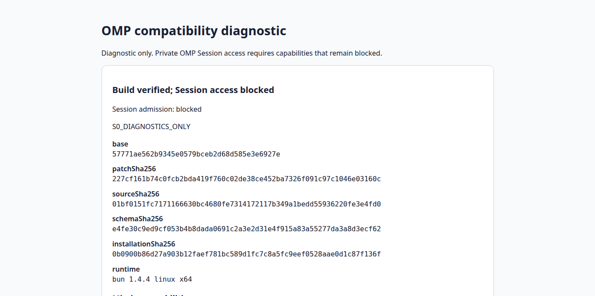

# Ticket #41 — OMP 19 candidate and actual global gate

## Matched candidate

- Integration merge: `413594a`; candidate source: `be19c4d75c`.
- OMP: `19.0.0`, base `57771ae562b9345e0579bceb2d68d585e3e6927e`.
- Source: `01bf0151fc7171166630bc4680fe7314172117b349a1bedd55936220fe3e4fd0`.
- Ordered patches: `227cf161b74c0fcb2bda419f760c02de38ce452ba7326f091c97c1046e03160c`.
- Schema: `e4fe30c9ed9cf053b4b8dada0691c2a3e2d31e4f915a83a55277da3a8d3ecf62`.
- Final enrolled installation: `0b0900b86d27a903b12faef781bc589d1fc7c8a5fc9eef0528aae0d1c87f136f` (34,115 assets).
- DSH navigation/draft/rebuild artifacts and their external-stage exclusions are listed in `ticket-41-navigation-roster.json`. The unenrolled strict stage is not claimed as a verified final runtime.

## Verification

The candidate worktree passed the full native-overlay `bun run check`: 950 pass, 5 skip, 0 fail, 6,498 assertions across 955 tests/137 files, plus lint, strict typecheck and Host build. Four skips are the explicitly unenrolled strict-validator stage; one is the pre-existing offline-model test. Native catalog, strict, interactions, live and attachment gates passed. Real PTY baseline refusal, matched-TUI continuation and baseline rollback passed. The merged tree was byte-identical to the tested candidate tree; after rebuilding the main checkout, navigation roster tests passed 6/6.

The original actual global `/home/howboring/.local/bin/omp` was backed up before replacement as `/home/howboring/.local/bin/omp.bak-19.0.0-original-20261119`, SHA256 `c7cc5c8d505053c8ffaf180417e5d5c781235b9d936f286810560151120109bf`. The global launcher now resolves to this checkout's `vendor/omp-candidate/cli.js`; `omp --version` reports `omp/19.0.0` and `omp --rpc-preflight` negotiates protocols 1 and 2.

The diagnostics Host was started with the enrolled launcher, manifest and independent manifest SHA256. A real Chromium page settled at **Build verified; Session access blocked**, code `S0_DIAGNOSTICS_ONLY`, displaying the exact identities above. Product/private Session admission remains blocked. Missing native, client-rebuild, private-admission and immutable-global capabilities are BLOCKED, not PASS. An attempted launch through the global symlink path correctly returned `INSTALLATION_UNVERIFIED` because the enrollment records the canonical candidate launcher; the canonical enrolled launcher and the global target were then verified separately.

## Rollback

Stop WebUI workers using the candidate, then restore the backup with `cp -a /home/howboring/.local/bin/omp.bak-19.0.0-original-20261119 /home/howboring/.local/bin/omp`. No real user Session or history was used for mutation/upgrade tests.
